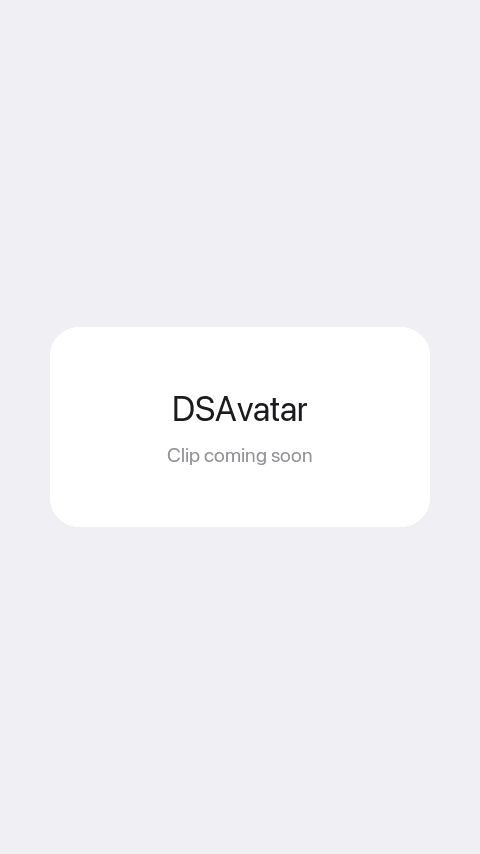

# DSAvatar

A circular avatar that loads a remote photo and falls back to tinted initials, so it never shows an empty circle.



**Platforms:** iOS 18+ · macOS 15+  ·  **Source:** [`DSBadge.swift`](../../Sources/VelvetUI/Components/DSBadge.swift)

## Install

```swift
// Package.swift
.package(url: "https://github.com/MatiasPC/velvet-ui.git", from: "0.2.0")
// target dependencies
.product(name: "VelvetUI", package: "velvet-ui")
```

In Xcode: File → Add Package Dependencies… → paste `https://github.com/MatiasPC/velvet-ui.git`. Inject the theme once at your app root (`@State private var theme = DSTheme(gradient: .sunset)` + `.dsTheme(theme)`); see [the README](../../README.md#install) for the full setup.

## Usage

```swift
import VelvetUI

struct AvatarDemo: View {
    var body: some View {
        DSScreen(backdrop: true) {
            VStack(alignment: .leading, spacing: DSSpacing.md) {
                HStack(spacing: DSSpacing.md) {
                    DSAvatar(name: "Ada Lovelace")
                    DSAvatar(name: "Grace Hopper", size: 56)
                    DSAvatar(name: "Linus", size: 32)
                }

                DSAvatar(
                    name: "Margaret Hamilton",
                    imageURL: URL(string: "https://example.com/margaret.jpg"),
                    size: 72
                )
                .accessibilityLabel("Margaret Hamilton")
            }
            .dsScreenPadding()
        }
    }
}
```

## Parameters

| Parameter | Type | Default | Description |
|---|---|---|---|
| `name` | `String` | required | Full name. Initials come from the first letter of the first and last words. |
| `imageURL` | `URL?` | `nil` | Remote photo, loaded with `AsyncImage`. |
| `size` | `CGFloat` | `40` | Diameter in points. |

## Variants

- **Initials** (no `imageURL`): accent at 15% fill with rounded semibold initials in `theme.ink`, sized at 40% of the avatar.
- **Photo**: the image is scaled to fill and clipped to a circle.
- **Fallback**: while the image loads or if it fails, the initials view is shown instead.
- A one-word name gives one letter (`"Linus"` gives `L`); `"Ada Lovelace"` gives `AL`; middle names are skipped.

## Behavior

- No motion and no haptics. Add `.dsPopIn()` for an entrance or `.dsBreathe()` for a "waiting" avatar (see [Motion](Motion.md)).
- Everything is derived from the theme, so the tint follows the active gradient.

## Accessibility

- The view carries no label of its own: VoiceOver reads the initials text (for example "AL") for the fallback, and nothing useful for a photo. Add `.accessibilityLabel("Ada Lovelace")` from outside, as in the snippet above.
- The initials use a font derived from `size`, so they scale with the avatar, not with Dynamic Type. Choose `size` for the layout you want.

## See also

- [DSListCell](DSListCell.md) (avatar as the leading view)
- [DSBadge](DSBadge.md) (count badge on an avatar)
- [Motion](Motion.md)
- [All components](../../README.md#components) · [Theming](../../README.md#theming)
