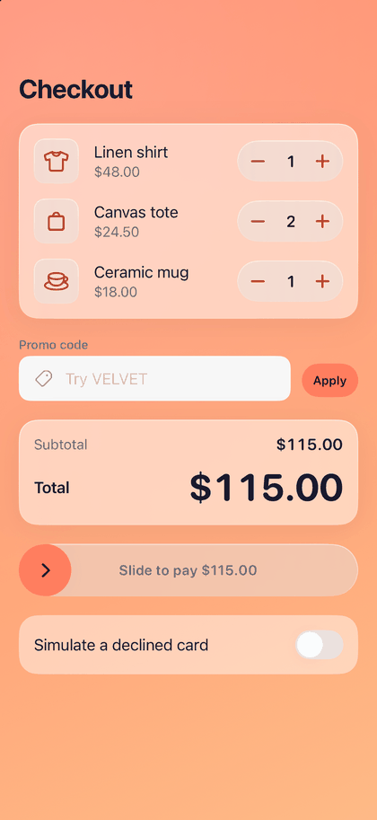

# Checkout

A cart with quantity steppers, a promo code, a rolling total and a slide to pay that ends in a confirmation.

> Example — not a component. Copy it and adapt it.



**Source:** [`CheckoutFlow.swift`](../../Examples/VelvetGallery/VelvetGallery/Flows/CheckoutFlow.swift)

## What it demonstrates

- [DSCard](../components/DSCard.md) and [DSStepper](../components/DSStepper.md): line items, each stepper labelled with the item name for VoiceOver.
- [DSTextField](../components/DSTextField.md) and [DSButton](../components/DSButton.md): the promo code with success and error states.
- [DSNumberTicker](../components/DSNumberTicker.md): the total rolls whenever a quantity or the promo changes.
- [DSSlideToConfirm](../components/DSSlideToConfirm.md): pay, with `finish: .morphAndVanish` handing off to the success state.
- [DSSuccessCheck](../components/DSSuccessCheck.md) and [DSConfetti](../components/DSConfetti.md): the confirmation.
- [DSEmptyState](../components/DSEmptyState.md): the empty cart.

## How it works

- Try the code `VELVET` for 10% off. Any other code shows the error state. Editing the code clears the result.
- The slide's `onConfirm` awaits `CheckoutService.charge` (about 1.2 s). Turn on "Simulate a declined card" to make it throw: the control re-opens and a message explains why.
- On success the view swaps to the confirmation with `DSAnimation.springSmooth`, and the confetti trigger is bumped on the same beat. The confetti is attached to the root container, which covers the screen.
- "Done" calls `onFinish()`, resets the cart, and remounts the slide with a new `.id` so it starts fresh.
- Set every quantity to 0 to see the empty state with "Restore cart". The pay control is hidden while the cart is empty.

## Run it

Gallery → Examples → Checkout.

## Copy it

```bash
swift velvet.swift add Checkout --dest MyApp/VelvetUI
```
