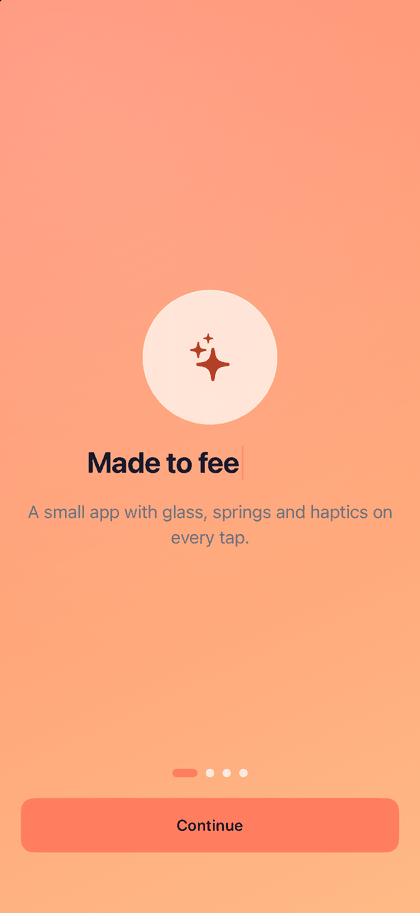

# Onboarding

A four-page onboarding: welcome, theme picker, notification preferences and a celebratory finish.

> Example — not a component. Copy it and adapt it.



**Source:** [`OnboardingFlow.swift`](../../Examples/VelvetGallery/VelvetGallery/Flows/OnboardingFlow.swift)

## What it demonstrates

- [DSButton](../components/DSButton.md): one full-width button that reads "Continue", then "Get started" on the last page.
- [DSPageControl](../components/DSPageControl.md): dots that follow the swipe and jump on tap.
- [DSTypewriterText](../components/DSTypewriterText.md): the welcome headline cycling through short phrases.
- [DSCard](../components/DSCard.md), [DSToggle](../components/DSToggle.md) and [DSSegmentedControl](../components/DSSegmentedControl.md): the preferences page.
- [DSSuccessCheck](../components/DSSuccessCheck.md) and [DSConfetti](../components/DSConfetti.md): the finish.
- Motion modifiers: `.dsBreathe(.subtle)` on the glyph and `.dsPopIn(delay:)` for staggered entrances ([Motion](../components/Motion.md)).

## How it works

- The flow owns a `DSTheme` in `@State` and injects it with `.dsTheme(theme)` at its root. The theme page sets `theme.gradient` inside `withAnimation(DSAnimation.normal)`, so the backdrop crossfades.
- Pages are a paging `TabView` on iOS. On macOS the flow shows the current page only.
- Each page builds its content only while it is the current page, so the pop-in stagger replays every visit.
- Arriving on the last page flips `DSSuccessCheck(isComplete:)` and bumps the confetti trigger on the same beat. The confetti is attached to the full-screen container, because it draws inside the view it is attached to.
- `onFinish` runs when you press "Get started".

## Run it

Gallery → Examples → Onboarding.

## Copy it

```bash
swift velvet.swift add Onboarding --dest MyApp/VelvetUI
```
