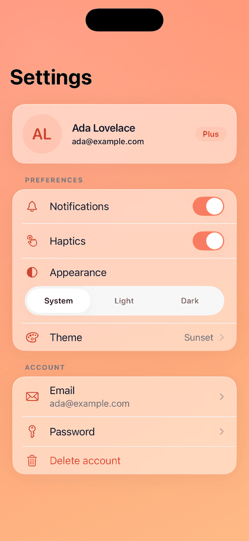

# Settings

A settings screen with a profile header, preference toggles, a theme detail screen and a slide-to-confirm account deletion.

> Example — not a component. Copy it and adapt it.



**Source:** [`SettingsFlow.swift`](../../Examples/VelvetGallery/VelvetGallery/Flows/SettingsFlow.swift)

## What it demonstrates

- [DSCard](../components/DSCard.md), [DSAvatar](../components/DSAvatar.md) and [DSBadge](../components/DSBadge.md): the profile header.
- [DSListCell](../components/DSListCell.md) with `DSDivider` and `DSSectionHeader`: grouped rows inside `DSCard(padding: 0)`.
- [DSToggle](../components/DSToggle.md) and [DSSegmentedControl](../components/DSSegmentedControl.md): preferences.
- [DSSheet](../components/DSSheet.md) and [DSSlideToConfirm](../components/DSSlideToConfirm.md): the delete-account confirmation, tinted with the error color.
- [DSToast](../components/DSToast.md): "Saved" feedback.

## How it works

- Appearance (System, Light, Dark) really drives `.preferredColorScheme` on the flow.
- The Theme row pushes a detail screen. Choosing a theme sets `theme.gradient` in `withAnimation`, so the backdrop crossfades behind the navigation bar.
- Changing any toggle, the appearance or the theme shows a "Saved" toast for about 1.6 s. There is one toast at a time: a new one replaces the old and restarts the timer.
- "Delete account" opens a sheet. The slide awaits a fake service, shows "Deleted", then the sheet closes and a toast confirms.
- Email and Password rows are navigation rows that show an info toast, to keep the example short.

## Run it

Gallery → Examples → Settings.

## Copy it

```bash
swift velvet.swift add Settings --dest MyApp/VelvetUI
```
